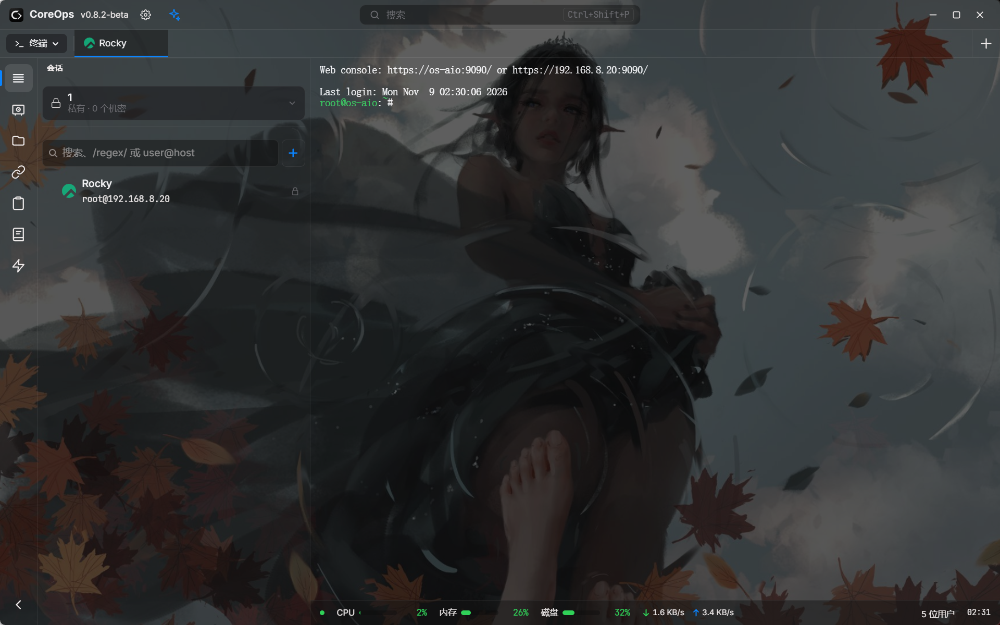

<p align="right">
  <a href="README.md">中文</a>
</p>

<p align="center">
  
</p>

<h1 align="center">CoreOps</h1>

<p align="center">
  A personal fork of <a href="https://github.com/alexandrosnt/Reach"><strong>Reach</strong></a> · Deeply customized for Chinese-speaking DevOps engineers
</p>

<p align="center">
  
  
  
  
</p>

---

## What is CoreOps

CoreOps is a cross-platform SSH client and remote operations tool, forked from [Reach](https://github.com/alexandrosnt/Reach) 0.8.8.

It keeps the full Reach foundation — native Rust SSH, SFTP, RDP/VNC, port forwarding, Ansible, OpenTofu, containers, Kubernetes, databases, and an encrypted vault — and adds two things for Chinese-speaking operations engineers:

1. **A complete Chinese interface**: menus, prompts, error messages, confirmations, and the AI panel.
2. **An enhanced AI operations assistant**: read the terminal, analyse it, generate commands, and inject them into the live terminal. It supports four execution modes, per-tab conversation contexts, and a gate for sudo and interactive prompts.

No Electron, no subscription, no account. Windows, macOS, Linux, and Android share one codebase.

---

## Features

### 1. AI Operations Assistant (CoreOps enhancement)

The AI panel sits beside the terminal and works with the current session, not as a detached chat window.

- **Reads the live terminal**: the recent terminal output is included automatically, so errors do not need to be copied by hand.
- **Runs code blocks**: shell commands in an AI reply can be injected into the current terminal with one click.
- **Run all commands**: when a reply contains several commands, execute them in order as one batch.
- **SSH / local PTY routing**: automatically uses `sshSend` or `ptyWrite` based on the active tab.
- **Per-tab context**: each tab keeps its own conversation, so switching tabs does not mix histories; closing a tab clears it.
- **Abort**: stop a response or an execution at any time.
- **Resizable panel**: drag the panel edge; the width is remembered.
- **sudo and interactive-command gate**: when a command asks for a sudo password, a confirmation, `[y/N]`, or Enter, execution pauses and a dialog waits for your input.
- **Dangerous-command detection**: in Auto Edit mode, service restarts, deletions, package management, disk operations, and firewall changes require confirmation first.

#### Four execution modes

| Mode | Behaviour |
|------|-----------|
| **Normal** | The AI can read the terminal and analyse it; commands run only when you click Run |
| **Plan only** | Analysis and plans only; no command can be executed |
| **Auto edit** | The AI may edit configuration files; high-risk commands still ask first |
| **Full auto** | The AI reads, executes, analyses, and continues automatically — use only in controlled environments |

The selected mode is stored locally and survives restarts.

#### AI configuration

- **Any OpenAI-compatible API**: DeepSeek, Qwen, SiliconFlow, local Ollama, OpenAI, and others.
- **Encrypted API key**: stored in the application vault, never written to a plain-text config file.
- **Model discovery**: fetch the available models from the configured endpoint, with search and filtering.
- **Model details**: context window and price per million tokens.
- **Base-URL handling**: with or without `/v1` both work; DeepSeek's `reasoning_content` is read correctly.
- **Restores after restart**: the key is loaded automatically once the vault is unlocked.

---

### 2. Connections and Terminals

- **SSH terminal**: tabs, split panes, tab groups, and WebGL rendering with xterm.js.
- **Your `~/.ssh/config`, all of it**: ProxyJump, ProxyCommand, ControlMaster, Kerberos (GSSAPI), X11 forwarding, PKCS#11 and FIDO2 keys, and the other keywords — 104 in total.
- **Jump hosts / multi-hop SSH**: imported from ssh_config or configured in the session editor.
- **OpenSSH-style authentication chain**: key → ssh-agent → password.
- **Host-key verification**: fingerprint confirmation on first use, and a clear warning when a known host presents a different key.
- **Reconnect**: dropped SSH tabs show their state and can reconnect with one click.
- **RDP and VNC**: remote desktops in a tab; RDP shares the clipboard, files, and a local folder as a drive.
- **WSL sessions**: open a WSL distribution in a tab on Windows, with user selection.
- **Local shells**: open a local terminal, optionally running a specific program (for example a container shell).
- **Serial console**: COM/TTY access for routers, switches, and embedded devices.
- **Terminal clipboard**: right-click to copy or paste, confirmation before multi-line paste, links open in the system browser.
- **Terminal colours follow the theme**, in dark and light modes.
- **Command palette**: `Ctrl+Shift+P` reaches sessions, tabs, pages, snippets, and actions.
- **Quick Connect**: type `user@host:port` and connect.
- **Start screen**: recent sessions, Quick Connect, and a local shell when no tab is open.

---

### 3. File Transfer and SFTP

- **SFTP explorer**: multi-tab browsing, path navigation, and permission display.
- **Drag and drop**: upload files by dropping them in, download by dragging them out.
- **Folder upload**: send a whole directory, including subfolders, as one transfer with one progress bar.
- **Edit in place**: open a remote file in the CodeMirror editor and save it back.
- **Compress and extract on the server**: no local download required.
- **Transfer queue**: progress, cancel, and retry.
- **Symlinks**: shown with a link icon and their real target; no meaningless size.
- **Real error messages**: download, delete, rename, new file, and new folder failures show the server's own error instead of failing silently.
- **Download integrity**: a dropped connection or a stalled server fails the download instead of leaving a truncated file that looks complete.

---

### 4. Networking and Tunnels

- **Local port forwarding**: map a remote port onto this machine.
- **Remote forwarding**: through `RemoteForward` in ssh_config.
- **Dynamic SOCKS proxy**: create one from the Tunnels panel and route it through the current SSH session.
- **Tunnels are saved with the session** and restored on reconnect.
- **ssh_config forwards**: LocalForward, RemoteForward, and DynamicForward are recognised automatically.
- **Proxy settings**: HTTP/SOCKS proxies can be combined with jump hosts.

---

### 5. Monitoring, Logs, and Audit

- **Live server statistics**: CPU, memory, disk, network, and logged-in users, with no agent installed.
- **Status bar**: connection state, latency, and disconnect/reconnect notices.
- **Session logging**: write terminal output to plain-text files.
- **Log redaction**: hosts, accounts, IPs, session names, and other private values are replaced when logs are shared or a report is generated.
- **Audit trail**: dangerous commands are flagged; AI-driven executions leave their command and output in the conversation.

---

### 6. Automation and DevOps (opt-in, in Settings → DevOps)

#### Ansible

- Playbooks, inventory, and role management.
- Streaming execution output with live task progress.
- On Windows, Ansible runs through WSL; it can also run in a container or on a remote Linux host.
- Built-in playbook templates and inventory generation.

#### OpenTofu / Terraform

- Full Plan / Apply / Destroy workflow.
- State browsing and resource inspection.
- HCL editor with variables, modules, providers, outputs, and locals.
- Visual resource and data-source pickers.
- State encryption, version management, and toolchain installation.
- Supports both OpenTofu and Terraform.

#### Containers and Kubernetes

- Manage Docker, Podman, and Compose.
- Container list, start/stop/remove, logs, file browser, and exec.
- Read file-based logs inside containers (glog, log4j, nginx, and others), including rotation.
- Kubernetes: pods, workloads, events, YAML, logs, and namespace switching.
- Helm support.
- Container and Kubernetes actions use the existing SSH session; no local kubectl is required.

#### Databases

- PostgreSQL, MySQL, MariaDB, SQL Server, SQLite, and Redis.
- Data grid, schema browsing, and a schema-aware SQL editor.
- The table designer shows the `ALTER` statement before it runs.
- Risk-scaled confirmations for destructive operations.
- Connect directly or through an SSH tunnel.
- Database backup and read-only mode.
- Send query results to the AI for analysis.

#### Recipes

- Parameterised scripts with declared parameters and a risk level.
- Built-in and imported recipes.
- Risk checks before execution.
- A reusable button for routine operations.

---

### 7. Security and Credentials

- **Encrypted vault**: sessions, passwords, SSH keys, and secrets are encrypted at rest.
- **Cryptography**: XChaCha20-Poly1305, Argon2id, and X25519.
- **Master password**: optional; unlock with Windows Hello, Touch ID, Android biometrics, or a FIDO2 security key.
- **Auto-lock**: locks when idle or when the system locks.
- **Encrypted cloud sync**: optional sync through Turso/libSQL across devices.
- **Shared vaults**: member invitations and shared sessions/folders.
- **Backup and restore**: encrypted, optionally password-protected backups.
- **Password managers**: Passbolt integration keeps the password out of CoreOps and fetches it only when connecting.
- **Zero-trust defaults**: features that open a door, such as session sharing and the MCP server, stay off until enabled.
- **Host-key verification**: trust on first use and a loud warning when a key changes.
- **Secret redaction**: passwords, tokens, private keys, and sync tokens are kept out of logs.

---

### 8. Collaboration and MCP

- **Session sharing**: two terminals side by side, peer-to-peer and end-to-end encrypted; the owner decides whether the guest can type.
- **MCP server**: hand the current session to Claude Code, Cursor, or any MCP client.
  - Listens on loopback only by default.
  - Guards against blind writes and secret reads.
  - Off by default and enabled manually.
- **Team members**: shared vaults support invitations and permissions.

---

### 9. Interface, Themes, and Plugins

- **Theme system**: built-in dark and light themes, plus third-party themes from the marketplace.
- **Whole-app theming**: title bar, sidebar, tab bar, panels, buttons, and status bar follow the theme, not only the terminal.
- **Terminal colours follow the theme**.
- **Design system**: consistent type scale, spacing, radii, shadows, and colour tokens.
- **Interface zoom**: `Ctrl+=` / `Ctrl+-` scales the whole window, `Ctrl+0` resets; terminal font size is separate.
- **Collapsible sidebar**, draggable width, and a drawer layout on phones.
- **Lua plugins**: sandboxed scripts, a plugin marketplace, and permission declarations.
- **Nine languages**: Chinese, English, German, Spanish, French, Italian, Greek, Bulgarian, and Russian.
- **Language picker** with search.
- **Mobile layout**: Esc/Ctrl/Alt/arrow keys above the keyboard, pinch to zoom, and safe areas for notches, status bars, and the keyboard.

---

### 10. Platforms, Updates, and Migration

- **Platforms**: Windows, macOS (Apple Silicon / Intel), Linux, and Android.
- **Installers**: Windows `.exe` / `.msi`, macOS `.dmg`, Linux `.AppImage` / `.deb` / `.rpm`, Android `.apk`.
- **Updates**: signed desktop updates; Android checks the GitHub release for an APK.
- **Upgrades keep your data**: the data directory remains `com.reach.app`, so sessions, vault, and settings survive.
- **Import**:
  - Bulk-import sessions from `~/.ssh/config`.
  - Bulk-import RDP hosts from a Termix export or JSON.
  - Import sessions, folders, and shared vaults.
- **Backup and restore**: full backup and restore.
- **About page**: version, project links, and a manual update check.

---

## What CoreOps changes vs upstream Reach

> Some of these were later adopted by upstream Reach (for example, session drag-and-drop and the theme system). CoreOps 0.8.0 continues to focus on the **enhanced AI assistant** and the **Chinese experience**.

### 1. Complete Chinese interface

The Chinese locale covers menus, buttons, prompts, errors, confirmations, and the AI panel.

### 2. Chinese AI operations assistant (the core change)

The AI panel turns “read the terminal → analyse → inject the command” into one loop, with four execution modes, per-tab contexts, a sudo/input gate, and run-all.

### 3. AI configuration panel

A dedicated AI tab in Settings: custom API base URL, encrypted key storage, model discovery, context window, and pricing.

### 4. Session drag-and-drop

CoreOps once rewrote session reordering with Pointer Events to work around HTML5 drag-and-drop problems in Tauri WebView2 on Windows; upstream later adopted this.

### 5. Custom background and appearance (new in 0.8.2)

**Settings → Appearance → Custom appearance** lets you pick a local picture as the app background, adjust its visibility, and override the primary/secondary text and accent colours. The picture is stored on this device only and is not synced with the vault.

The terminal keeps the theme's solid colour by default. Turn on **Terminal background** and it shows the picture like the rest of the interface, applying immediately to open terminals.

Settings, confirmation dialogs, dropdown menus and the command palette never show the interface behind them: each shows the matching part of the picture at its own position, covering what it should and staying aligned with the wallpaper.



---

## Inherited from Reach 0.8.8

Everything below comes from upstream Reach 0.8.8:

- SSH terminals, split panes, tab groups, and WebGL rendering
- RDP / VNC remote desktops
- SFTP explorer, folder upload, and in-place editing
- Port forwarding, SOCKS proxies, and jump hosts
- System monitoring and session logging
- Command palette, start screen, and Quick Connect
- WSL, local shells, and serial console
- Ansible and OpenTofu / Terraform
- Containers, Kubernetes, and databases
- Encrypted vault, cloud sync, and shared vaults
- Password managers (Passbolt)
- Session sharing and the MCP server
- Themes, the theme marketplace, and Lua plugins
- Nine languages and the mobile layout
- Auto-update, backup/restore, and host-key verification

---

## Tech stack

| Layer | Technology |
|-------|------------|
| Desktop shell | Tauri v2 |
| Backend | Rust · Tokio · russh (native SSH, no OpenSSH dependency) |
| Frontend | Svelte 5 (runes) · SvelteKit · TypeScript |
| Styling | Tailwind CSS v4 · CSS custom properties |
| Terminal | xterm.js with WebGL |
| Cryptography | XChaCha20-Poly1305 · Argon2id · X25519 |
| Storage | SQLite (libsql) |

---

## Download and install

Download from GitHub Releases:

```text
https://github.com/Daniel-King-8/CoreOps/releases
```

- Windows: `.exe` or `.msi`
- macOS: `.dmg` (Apple Silicon / Intel)
- Linux: `.AppImage` / `.deb` / `.rpm`
- Android: `.apk`

> Installing a new version replaces the old one. Sessions, the vault, and settings live in the `com.reach.app` data directory and are not removed.

---

## Build from source

Requirements: [Rust 1.99+](https://rustup.rs), [Node.js 22.17+](https://nodejs.org), and the [Tauri v2 prerequisites](https://v2.tauri.app/start/prerequisites/) for your OS.

```bash
git clone https://github.com/Daniel-King-8/CoreOps.git
cd CoreOps

npm install
npm run tauri dev      # development
npm run tauri build    # production installers
```

### Configure the AI assistant

1. Open the app → Settings → **AI**.
2. Enter the API base URL (the default is `https://api.deepseek.com/v1`; any OpenAI-compatible endpoint works).
3. Enter the API key and click **Validate and fetch models**.
4. Pick a model and enable the AI switch.
5. Click the AI icon at the top right of the terminal to open the panel.

---

## Changelog

### v0.8.2

- Added Custom appearance: pick a local picture as the app background, adjust its visibility, and override the primary/secondary text and accent colours
- Added a terminal background switch: keep the theme's solid terminal colour, or let the terminal show the custom picture like the rest of the interface. Open terminals update immediately
- Settings, confirmation dialogs, dropdown menus and the command palette no longer show the interface behind them; they show the matching part of the picture only
- Session group dropdown: right-clicking a group keeps the list open, with the rename/delete menu on top
- The Windows installer now offers Simplified Chinese and English, defaulting to Chinese on Chinese systems
- Version set to 0.8.2

### ~~v0.8.1~~

- ~~Fixed session drag-and-drop reordering; the order is remembered on this device~~
- ~~The session list now uses "session groups" throughout: group heading, search, and create button~~
- ~~"Private (this device)" is now "Default session group"~~
- ~~Session groups have a right-click menu with Rename and Delete~~
- ~~Added "Move session" to the session context menu, to move a session to another session group~~
- ~~Folders can be renamed from their context menu~~
- ~~Version set to 0.8.1~~

### ~~v0.8.0~~

~~Rebased on upstream Reach v0.8.8 while keeping every CoreOps customization.~~

- ~~New base: ported from Reach 0.8.8, with all upstream features and fixes~~
- ~~Upstream additions: RDP/VNC tabs, command palette, split view and tab groups, WSL sessions, container/Kubernetes/database workspaces, password-manager integration, theme marketplace, host-key verification, file and folder upload, and more~~
- ~~Kept the enhanced CoreOps AI assistant: Normal / Plan Only / Auto Edit / Full Auto~~
- ~~Kept per-tab AI conversations with cleanup on tab close~~
- ~~Kept the interactive-command gate for sudo prompts and confirmations~~
- ~~Kept custom OpenAI-compatible API base URLs (DeepSeek, Qwen, SiliconFlow, Ollama, ...)~~
- ~~Kept model discovery, context/pricing display, and automatic `/v1` handling~~
- ~~Kept run-all/multi-command execution, abort, and resizable panel width~~
- ~~Version set to 0.8.0; the update feed remains CoreOps' own GitHub release~~

### Older releases

See [CHANGELOG.md](CHANGELOG.md) for earlier changes.

---

## Acknowledgements

Thanks to **[@alexandrosnt](https://github.com/alexandrosnt)** for creating Reach. All of CoreOps' SSH capabilities come from Reach; this project only adds a personal layer on top.

**Upstream project: [https://github.com/alexandrosnt/Reach](https://github.com/alexandrosnt/Reach)**

---

## Final notes

I am not a professional programmer, so this project will have rough edges and bugs. Thank you for your patience.

The goal is simple: make my own operations work smoother, and hopefully help others with similar needs.

If you find a bug, have a suggestion, or just want to talk, contact me:

📮 **Email: [1007887927@qq.com](mailto:1007887927@qq.com)**

> CoreOps is a personal fork tailored to my own operations workflow and does not represent the official Reach project.
> If you are looking for an SSH client, the original Reach is absolutely worth checking out.
